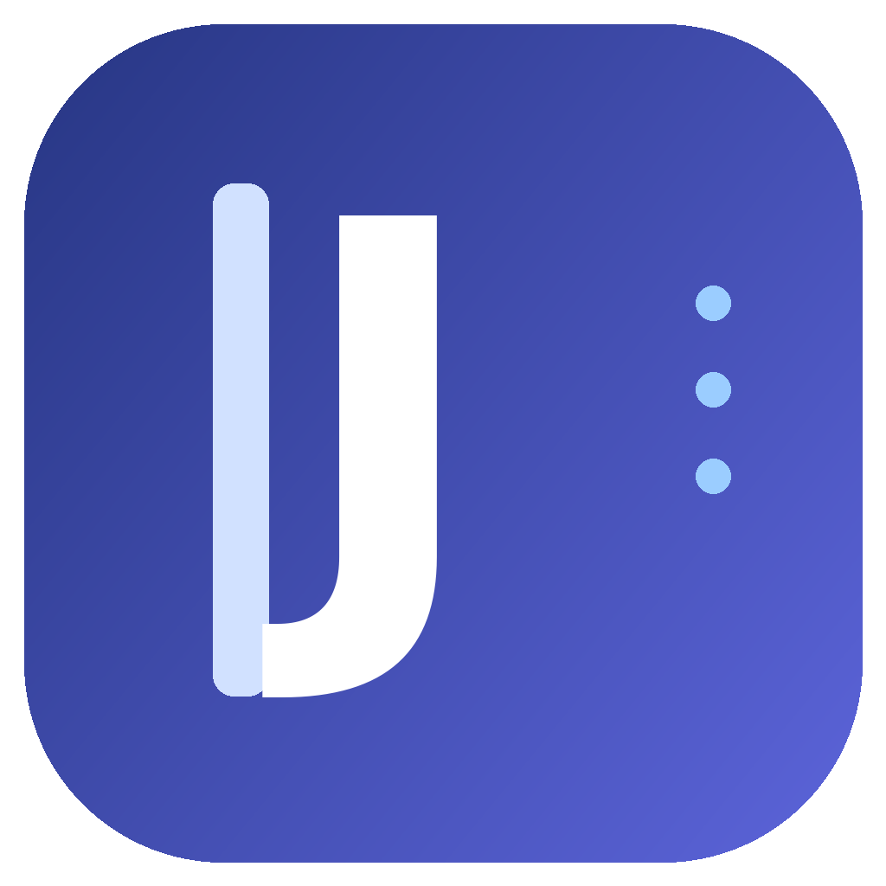

# JavaJournal

**Электронный журнал для студентов TOP Academy**

Неофициальное настольное приложение с расписанием, домашними заданиями и учебной статистикой.

**Windows 10/11 · macOS Intel · macOS Apple Silicon**

[Скачать приложение](https://github.com/PaCcBeTu3aKaT/JavaJournal/releases/latest) · [Все версии](https://github.com/PaCcBeTu3aKaT/JavaJournal/releases)

## Возможности

- **Расписание:** просмотр по дням и неделям, переход к сегодняшнему дню и ближайшей паре.
- **Домашние задания:** фильтры по статусам, сортировка по предметам и дедлайнам, режимы списка и плиток.
- **Подробности заданий:** описания, комментарии преподавателей, материалы и скачивание доступных вложений.
- **Оценки и посещаемость:** статистика за месяц или учебный год.
- **Профиль:** данные студента, группа, текущая версия приложения.
- **Оформление:** светлая и тёмная темы.
- **Обновления:** уведомление о новых версиях, опубликованных в GitHub Releases.

## Скачать

Готовые приложения размещаются в разделе [**Releases**](https://github.com/PaCcBeTu3aKaT/JavaJournal/releases/latest). Выберите архив для своей системы:

| Система | Что скачать | Как запустить |
| --- | --- | --- |
| **Windows 10/11 (x64)** | [Архив Windows](https://github.com/PaCcBeTu3aKaT/JavaJournal/releases/latest) — `JavaJournal-v*-windows-portable.zip` | Распаковать архив полностью и открыть `JavaJournal.exe` |
| **macOS — Intel** | [Архив macOS Intel](https://github.com/PaCcBeTu3aKaT/JavaJournal/releases/latest) — `JavaJournal-v*-macos-intel.zip` | Распаковать и открыть `JavaJournal.app` |
| **macOS — Apple Silicon** | [Архив macOS ARM](https://github.com/PaCcBeTu3aKaT/JavaJournal/releases/latest) — `JavaJournal-v*-macos-arm64.zip` | Распаковать и открыть `JavaJournal.app` |
| **Android** | В разработке | APK пока не опубликован |

Готовые сборки включают Java Runtime: устанавливать Java отдельно для их запуска не требуется. Для macOS приложение пока не подписано сертификатом Apple, поэтому система может запросить дополнительное подтверждение открытия.

> Если архивов для вашей системы пока нет в Releases, значит соответствующая сборка ещё не опубликована. Автоматическая публикация сборок не используется.

## Как пользоваться

1. Скачайте подходящий архив из Releases и распакуйте его.
2. Запустите JavaJournal.
3. Войдите с помощью учётной записи TOP Academy.
4. Откройте нужный раздел в меню приложения.

Для работы с учебными данными требуется доступ к серверам TOP Academy.

## Текущие ограничения

Скачивание доступных вложений поддерживается. **Отправка домашнего задания, удаление отправленной работы и запрос на пересдачу пока не выполняются:** соответствующие серверные операции ещё не подключены. Отдельная вкладка лабораторных работ также находится в планах.

Обновления не устанавливаются автоматически: приложение предлагает открыть страницу или скачать архив нового релиза.

## О проекте

JavaJournal — **независимый неофициальный клиент** электронного журнала TOP Academy. Проект не является официальным продуктом академии и не представляет её интересы.

Исходный код написан на **Java 21** с использованием **JavaFX**. Репозиторий содержит исходники и Gradle Wrapper; готовые приложения распространяются отдельно через GitHub Releases.

[Репозиторий JavaJournal](https://github.com/PaCcBeTu3aKaT/JavaJournal)
